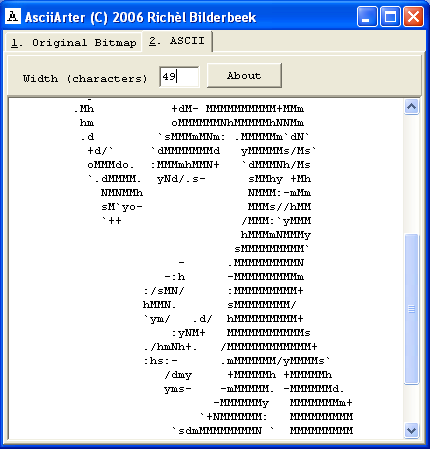

# AsciiArter (VCL)

Convert images to [ASCII art](https://github.com/richelbilderbeek/cpp/blob/master/content/CppAsciiArt.md).

AsciiArter (VCL) is one of [Richèl Bilderbeek's tools](https://richelbilderbeek.github.io/tools/).

## Links

- [Source code](https://github.com/richelbilderbeek/AsciiArterVcl)
- [Richèl Bilderbeek's tools](https://richelbilderbeek.github.io/tools/)
